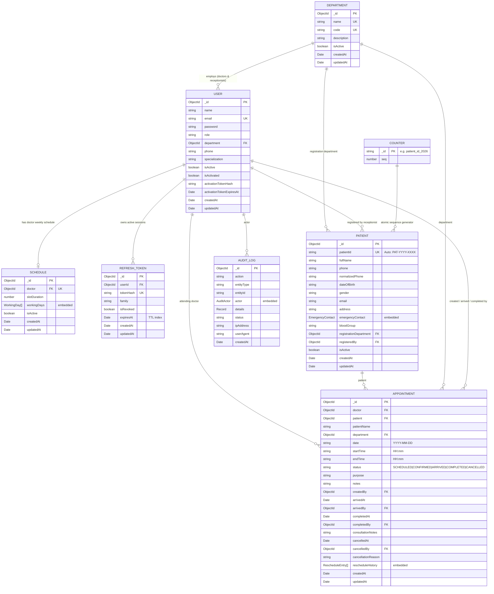

# Database Schema & Entity Relationships

This document provides a comprehensive technical reference for the MongoDB database schema powering the Enterprise EMR Appointment Management System. It details entity relationships, collections, data models, compound and partial indexes, invariant guarantees, and concrete sample documents.

---

## 1. Entity-Relationship Diagram (ERD)



---

## 2. Collections Specification

### 2.1 `departments` Collection
Stores clinical and administrative departments (e.g., Cardiology, General Medicine, Pediatrics).

#### Schema Fields
| Field | Type | Required | Description |
|---|---|---|---|
| `_id` | `ObjectId` | Yes | Primary key. |
| `name` | `string` | Yes | Unique department name (e.g., `"Cardiology"`). |
| `code` | `string` | Yes | Unique uppercase department code (e.g., `"CARD"`). |
| `description` | `string` | No | Description of medical scope. Default: `""`. |
| `isActive` | `boolean` | Yes | Soft-deletion flag. Default: `true`. |
| `createdAt` | `Date` | Yes | Managed by Mongoose timestamps. |
| `updatedAt` | `Date` | Yes | Managed by Mongoose timestamps. |

#### Indexes
- `{ name: 1 }` — Unique index enforcing department name uniqueness.
- `{ code: 1 }` — Unique index enforcing department uppercase code uniqueness.
- `{ isActive: 1 }` — Standard B-tree index for filtering active departments in select dropdowns.

#### Sample Document
```json
{
  "_id": { "$oid": "670f00010000000000000001" },
  "name": "Cardiology",
  "code": "CARD",
  "description": "Comprehensive cardiac and vascular care",
  "isActive": true,
  "createdAt": { "$date": "2026-10-15T08:00:00.000Z" },
  "updatedAt": { "$date": "2026-10-15T08:00:00.000Z" }
}
```

---

### 2.2 `users` Collection
Stores system actors: `SUPER_ADMIN`, `DOCTOR`, and `RECEPTIONIST`.

#### Schema Fields
| Field | Type | Required | Description |
|---|---|---|---|
| `_id` | `ObjectId` | Yes | Primary key. |
| `name` | `string` | Yes | Full name of the staff member. |
| `email` | `string` | Yes | Lowercase unique email address. |
| `password` | `string` | No | Bcrypt hashed password (`select: false`). |
| `role` | `string` | Yes | Enum: `'SUPER_ADMIN' \| 'DOCTOR' \| 'RECEPTIONIST'`. |
| `department` | `ObjectId \| null` | No | Ref to `Department`. Required for Receptionists, optional for Doctors, null for Super Admin. |
| `phone` | `string` | No | Contact telephone number. |
| `specialization` | `string` | No | Clinical specialty (e.g., `"Cardiologist"`). |
| `isActive` | `boolean` | Yes | Active/Deactivated account state. Default: `true`. |
| `isActivated` | `boolean` | Yes | Whether password has been set via email link. Default: `false`. |
| `activationTokenHash` | `string` | No | SHA-256 hash of activation token (`select: false`). |
| `activationTokenExpiresAt`| `Date` | No | Expiration timestamp for activation link. |
| `createdAt` | `Date` | Yes | Timestamp. |
| `updatedAt` | `Date` | Yes | Timestamp. |

#### Indexes & Invariants
1. `{ email: 1 }` (Unique): Prevents duplicate accounts.
2. `{ isActive: 1 }`, `{ isActivated: 1 }`: Accelerated login verification.
3. **Partial Unique Index (One Active Receptionist Per Department Invariant)**:
   ```javascript
   { department: 1 },
   {
     unique: true,
     partialFilterExpression: {
       role: "RECEPTIONIST",
       isActive: true,
       department: { $type: "objectId" }
     }
   }
   ```
   *Guarantees at database level that no two active receptionists can be assigned to the same department simultaneously.*

#### Sample Document
```json
{
  "_id": { "$oid": "670f00020000000000000002" },
  "name": "Dr. Sarah Jenkins",
  "email": "dr.jenkins@hospital.com",
  "role": "DOCTOR",
  "department": { "$oid": "670f00010000000000000001" },
  "phone": "+1-555-0102",
  "specialization": "Interventional Cardiology",
  "isActive": true,
  "isActivated": true,
  "createdAt": { "$date": "2026-10-15T08:05:00.000Z" },
  "updatedAt": { "$date": "2026-10-15T08:05:00.000Z" }
}
```

---

### 2.3 `schedules` Collection
Stores doctors' weekly recurring availability templates, slot granularity, sessions, and breaks.

#### Embedded Types
- **`ISession`**: `{ startTime: string (HH:mm), endTime: string (HH:mm), label?: string }`
- **`IBreak`**: `{ startTime: string (HH:mm), endTime: string (HH:mm), label?: string }`
- **`IWorkingDay`**: `{ dayOfWeek: number (0-6), dayName: string, isEnabled: boolean, sessions: ISession[], breaks: IBreak[] }`

#### Schema Fields
| Field | Type | Required | Description |
|---|---|---|---|
| `_id` | `ObjectId` | Yes | Primary key. |
| `doctor` | `ObjectId` | Yes | Ref to `User` (Unique: 1 schedule per doctor). |
| `slotDuration` | `number` | Yes | Granularity in minutes (15, 20, 30, 45, 60). Default: `15`. |
| `workingDays` | `IWorkingDay[]` | Yes | Embedded weekly array covering Sunday (0) to Saturday (6). |
| `isActive` | `boolean` | Yes | Schedule template active state. |
| `createdAt` | `Date` | Yes | Timestamp. |
| `updatedAt` | `Date` | Yes | Timestamp. |

#### Indexes
- `{ doctor: 1 }` (Unique): Ensures each doctor has exactly one weekly schedule configuration.
- `{ isActive: 1 }`: Filters active templates.

#### Sample Document
```json
{
  "_id": { "$oid": "670f00030000000000000003" },
  "doctor": { "$oid": "670f00020000000000000002" },
  "slotDuration": 15,
  "isActive": true,
  "workingDays": [
    {
      "dayOfWeek": 1,
      "dayName": "MONDAY",
      "isEnabled": true,
      "sessions": [
        { "startTime": "09:00", "endTime": "13:00", "label": "Morning Clinic" },
        { "startTime": "14:00", "endTime": "17:00", "label": "Afternoon Rounds" }
      ],
      "breaks": [
        { "startTime": "13:00", "endTime": "14:00", "label": "Lunch Break" }
      ]
    }
  ],
  "createdAt": { "$date": "2026-10-15T08:10:00.000Z" },
  "updatedAt": { "$date": "2026-10-15T08:10:00.000Z" }
}
```

---

### 2.4 `patients` Collection
Stores patient demographic and contact records with sequential unique hospital IDs.

#### Schema Fields
| Field | Type | Required | Description |
|---|---|---|---|
| `_id` | `ObjectId` | Yes | Primary key. |
| `patientId` | `string` | Yes | Human-readable sequential ID (e.g., `"PAT-2026-0001"`). Unique. |
| `fullName` | `string` | Yes | Full legal name. |
| `phone` | `string` | Yes | Raw input phone number. |
| `normalizedPhone` | `string` | Yes | Digits-only normalized phone for fast lookups. |
| `dateOfBirth` | `string` | Yes | Format: `"YYYY-MM-DD"`. |
| `gender` | `string` | Yes | Enum: `'MALE' \| 'FEMALE' \| 'OTHER'`. |
| `email` | `string` | No | Optional email address. |
| `address` | `string` | No | Residential address. |
| `emergencyContact` | `EmergencyContact`| No | Embedded `{ name, phone, relationship }`. |
| `bloodGroup` | `string` | No | Enum: `'A+' \| 'A-' \| 'B+' \| 'B-' \| 'AB+' \| 'AB-' \| 'O+' \| 'O-' \| 'UNKNOWN'`. |
| `registrationDepartment`| `ObjectId` | No | Ref to `Department` where patient first enrolled. |
| `registeredBy` | `ObjectId` | Yes | Ref to `User` (receptionist who registered). |
| `isActive` | `boolean` | Yes | Active status. Default: `true`. |
| `createdAt` | `Date` | Yes | Timestamp. |
| `updatedAt` | `Date` | Yes | Timestamp. |

#### Indexes
- `{ patientId: 1 }` (Unique): Fast exact-match lookup by hospital ID.
- `{ normalizedPhone: 1 }`: Fast lookup during receptionist phone search.
- `{ fullName: 1 }`: Case-insensitive text search and sorting.
- `{ dateOfBirth: 1 }`: Fast index for date queries.
- `{ fullName: 1, dateOfBirth: 1 }` (Compound): Pre-screening duplicate patient detection.

#### Sample Document
```json
{
  "_id": { "$oid": "670f00040000000000000004" },
  "patientId": "PAT-2026-0001",
  "fullName": "Robert Chen",
  "phone": "+1 (555) 234-5678",
  "normalizedPhone": "15552345678",
  "dateOfBirth": "1985-04-12",
  "gender": "MALE",
  "email": "robert.chen@example.com",
  "address": "452 Elm Street, Seattle, WA",
  "bloodGroup": "O+",
  "emergencyContact": {
    "name": "Linda Chen",
    "phone": "+1 (555) 234-5679",
    "relationship": "Spouse"
  },
  "registrationDepartment": { "$oid": "670f00010000000000000001" },
  "registeredBy": { "$oid": "670f00020000000000000003" },
  "isActive": true,
  "createdAt": { "$date": "2026-10-15T08:15:00.000Z" },
  "updatedAt": { "$date": "2026-10-15T08:15:00.000Z" }
}
```

---

### 2.5 `appointments` Collection
The core operational collection managing appointment lifecycle, transitions, and doctor privacy boundaries.

#### Schema Fields
| Field | Type | Required | Description |
|---|---|---|---|
| `_id` | `ObjectId` | Yes | Primary key. |
| `doctor` | `ObjectId` | Yes | Ref to `User` (attending doctor). |
| `patient` | `ObjectId` | No | Ref to `Patient`. |
| `patientName` | `string` | No | Denormalized patient name for fast queries. |
| `department` | `ObjectId` | Yes | Ref to `Department`. |
| `date` | `string` | Yes | Format: `"YYYY-MM-DD"`. |
| `startTime` | `string` | Yes | Format: `"HH:mm"` (24-hour). |
| `endTime` | `string` | Yes | Format: `"HH:mm"` (24-hour). |
| `status` | `string` | Yes | Enum: `'SCHEDULED' \| 'CONFIRMED' \| 'ARRIVED' \| 'COMPLETED' \| 'CANCELLED' \| 'NO_SHOW' \| 'PENDING' \| 'RESCHEDULED'`. |
| `purpose` | `string` | No | Reason for consultation. |
| `notes` | `string` | No | General reception notes. |
| `createdBy` | `ObjectId` | No | Ref to `User` (creator). |
| `arrivedAt` | `Date` | No | Timestamp of check-in. |
| `arrivedBy` | `ObjectId` | No | Ref to `User` (receptionist who checked patient in). |
| `completedAt` | `Date` | No | Timestamp of completion. |
| `completedBy` | `ObjectId` | No | Ref to `User` (doctor who completed consultation). |
| `consultationNotes` | `string` | No | Doctor's confidential medical notes. |
| `cancelledAt` | `Date` | No | Timestamp of cancellation. |
| `cancelledBy` | `ObjectId` | No | Ref to `User` who cancelled. |
| `cancellationReason`| `string` | No | Reason for appointment cancellation. |
| `rescheduleHistory`| `Entry[]` | No | Audit list of prior dates and times. |
| `createdAt` | `Date` | Yes | Timestamp. |
| `updatedAt` | `Date` | Yes | Timestamp. |

#### Indexes & Concurrency Protections
1. **Double-Booking Partial Unique Index (`unique_active_doctor_slot`)**:
   ```javascript
   { doctor: 1, date: 1, startTime: 1 },
   {
     unique: true,
     partialFilterExpression: {
       status: { $in: ["SCHEDULED", "CONFIRMED", "ARRIVED"] }
     },
     name: "unique_active_doctor_slot"
   }
   ```
   *Guarantees zero concurrent double-booking. When an appointment is CANCELLED or COMPLETED, it leaves the partial index, freeing the slot instantly.*
2. `{ patient: 1, date: 1 }`: Rapid lookup of patient visit history.
3. `{ department: 1, date: 1 }`: Departmental schedule queries.
4. `{ doctor: 1, date: 1, status: 1 }`: Doctor daily schedule filtered by status.
5. `{ department: 1, date: 1, status: 1 }`: Receptionist dashboard queries.
6. `{ date: 1, startTime: 1 }`: Chronological slot ordering.
7. `{ status: 1, date: 1 }`: Filter by lifecycle state over date ranges.

#### Sample Document
```json
{
  "_id": { "$oid": "670f00050000000000000005" },
  "doctor": { "$oid": "670f00020000000000000002" },
  "patient": { "$oid": "670f00040000000000000004" },
  "patientName": "Robert Chen",
  "department": { "$oid": "670f00010000000000000001" },
  "date": "2026-10-18",
  "startTime": "09:30",
  "endTime": "09:45",
  "status": "ARRIVED",
  "purpose": "Post-operative follow-up and ECG review",
  "notes": "Patient requested wheelchair assistance",
  "createdBy": { "$oid": "670f00020000000000000003" },
  "arrivedAt": { "$date": "2026-10-18T09:25:00.000Z" },
  "arrivedBy": { "$oid": "670f00020000000000000003" },
  "consultationNotes": "",
  "rescheduleHistory": [],
  "createdAt": { "$date": "2026-10-15T08:20:00.000Z" },
  "updatedAt": { "$date": "2026-10-18T09:25:00.000Z" }
}
```

---

### 2.6 `refresh_tokens` Collection
Stores hashed refresh tokens supporting silent token rotation and token family revocation.

#### Schema Fields
| Field | Type | Required | Description |
|---|---|---|---|
| `_id` | `ObjectId` | Yes | Primary key. |
| `userId` | `ObjectId` | Yes | Ref to `User`. |
| `tokenHash` | `string` | Yes | SHA-256 hash of refresh token. |
| `family` | `string` | Yes | UUID grouping tokens within a single login session. |
| `isRevoked` | `boolean` | Yes | Invalidation flag. Default: `false`. |
| `expiresAt` | `Date` | Yes | Expiration timestamp. TTL index auto-deletes document. |
| `createdAt` | `Date` | Yes | Timestamp. |
| `updatedAt` | `Date` | Yes | Timestamp. |

#### Indexes
- `{ tokenHash: 1 }` (Unique): Fast token lookup.
- `{ userId: 1 }`: Query user active sessions.
- `{ family: 1 }`: Token family lookup for revocation cascades.
- `{ expiresAt: 1 }` (`expireAfterSeconds: 0`): MongoDB TTL index for automatic physical eviction.

#### Sample Document
```json
{
  "_id": { "$oid": "670f00060000000000000006" },
  "userId": { "$oid": "670f00020000000000000002" },
  "tokenHash": "e3b0c44298fc1c149afbf4c8996fb92427ae41e4649b934ca495991b7852b855",
  "family": "8f86f322-1f48-4cb2-9bb2-1262d057a79a",
  "isRevoked": false,
  "expiresAt": { "$date": "2026-10-23T08:00:00.000Z" },
  "createdAt": { "$date": "2026-10-16T08:00:00.000Z" },
  "updatedAt": { "$date": "2026-10-16T08:00:00.000Z" }
}
```

---

### 2.7 `counters` Collection
Provides race-condition-free atomic integer sequences using MongoDB's `$inc` operator.

#### Schema Fields
| Field | Type | Required | Description |
|---|---|---|---|
| `_id` | `string` | Yes | Sequence identifier (e.g., `"patient_id_2026"`). |
| `seq` | `number` | Yes | Monotonically increasing counter value. |

#### Invariant Mechanism
Sequential ID allocation uses:
```typescript
CounterModel.findByIdAndUpdate(
  name,
  { $inc: { seq: 1 } },
  { new: true, upsert: true, setDefaultsOnInsert: true }
);
```
*Because MongoDB document updates are atomic at the single-document level, two concurrent patient registrations never receive the same sequential counter value.*

#### Sample Document
```json
{
  "_id": "patient_id_2026",
  "seq": 142
}
```

---

### 2.8 `audit_logs` Collection
Immutable append-only audit trail capturing security and administrative events.

#### Schema Fields
| Field | Type | Required | Description |
|---|---|---|---|
| `_id` | `ObjectId` | Yes | Primary key. |
| `action` | `string` | Yes | Event action (e.g., `"USER_LOGIN"`, `"APPOINTMENT_CREATE"`). |
| `entityType` | `string` | Yes | Resource type (e.g., `"APPOINTMENT"`, `"PATIENT"`). |
| `entityId` | `string` | No | ID of affected entity. |
| `actor` | `AuditActor` | No | Embedded `{ userId, email, name, role }`. |
| `details` | `Record` | No | Structured metadata detailing state delta. |
| `status` | `string` | Yes | Enum: `'SUCCESS' \| 'FAILURE'`. |
| `ipAddress` | `string` | No | Client IP address. |
| `userAgent` | `string` | No | Client User-Agent string. |
| `createdAt` | `Date` | Yes | Event timestamp (`index: true`). |

#### Indexes
- `{ createdAt: -1 }`: Chronological log browsing.
- `{ action: 1, createdAt: -1 }`: Filter by specific operational actions.
- `{ entityType: 1, createdAt: -1 }`: Audit trail per resource type.
- `{ 'actor.userId': 1, createdAt: -1 }`: Auditor inspection of user actions.
- `{ 'actor.email': 1, createdAt: -1 }`: Auditor inspection by actor email.

#### Sample Document
```json
{
  "_id": { "$oid": "670f00080000000000000008" },
  "action": "APPOINTMENT_STATUS_UPDATE",
  "entityType": "APPOINTMENT",
  "entityId": "670f00050000000000000005",
  "actor": {
    "userId": { "$oid": "670f00020000000000000003" },
    "email": "receptionist.card@hospital.com",
    "name": "Alex Miller",
    "role": "RECEPTIONIST"
  },
  "details": {
    "previousStatus": "CONFIRMED",
    "newStatus": "ARRIVED",
    "patientId": "PAT-2026-0001"
  },
  "status": "SUCCESS",
  "ipAddress": "192.168.1.104",
  "userAgent": "Mozilla/5.0 (Windows NT 10.0; Win64; x64) Chrome/129.0.0.0",
  "createdAt": { "$date": "2026-10-18T09:25:00.000Z" }
}
```

---

## 3. Index Summary Matrix

| Collection | Index Fields | Type | Purpose |
|---|---|---|---|
| `users` | `{ email: 1 }` | Unique | Prevent duplicate accounts |
| `users` | `{ department: 1 }` | Partial Unique | **Single active receptionist invariant** |
| `departments` | `{ name: 1 }` | Unique | Prevent duplicate department names |
| `departments` | `{ code: 1 }` | Unique | Prevent duplicate department codes |
| `schedules` | `{ doctor: 1 }` | Unique | Ensure single schedule per doctor |
| `patients` | `{ patientId: 1 }` | Unique | Hospital ID fast lookup |
| `patients` | `{ normalizedPhone: 1 }` | B-tree | Fast telephone lookups |
| `patients` | `{ fullName: 1, dateOfBirth: 1 }` | Compound | **Duplicate patient pre-screening** |
| `appointments`| `{ doctor: 1, date: 1, startTime: 1 }` | Partial Unique | **Double-booking concurrency prevention** |
| `appointments`| `{ patient: 1, date: 1 }` | Compound | Patient consultation history |
| `appointments`| `{ department: 1, date: 1, status: 1 }` | Compound | Receptionist daily dashboard |
| `appointments`| `{ doctor: 1, date: 1, status: 1 }` | Compound | Doctor clinic schedule |
| `refresh_tokens`| `{ tokenHash: 1 }` | Unique | Fast token verification |
| `refresh_tokens`| `{ expiresAt: 1 }` | TTL | Auto-expire sessions |
| `audit_logs` | `{ createdAt: -1 }` | B-tree | Chronological audit trail |
| `audit_logs` | `{ 'actor.userId': 1, createdAt: -1 }` | Compound | User audit investigations |
